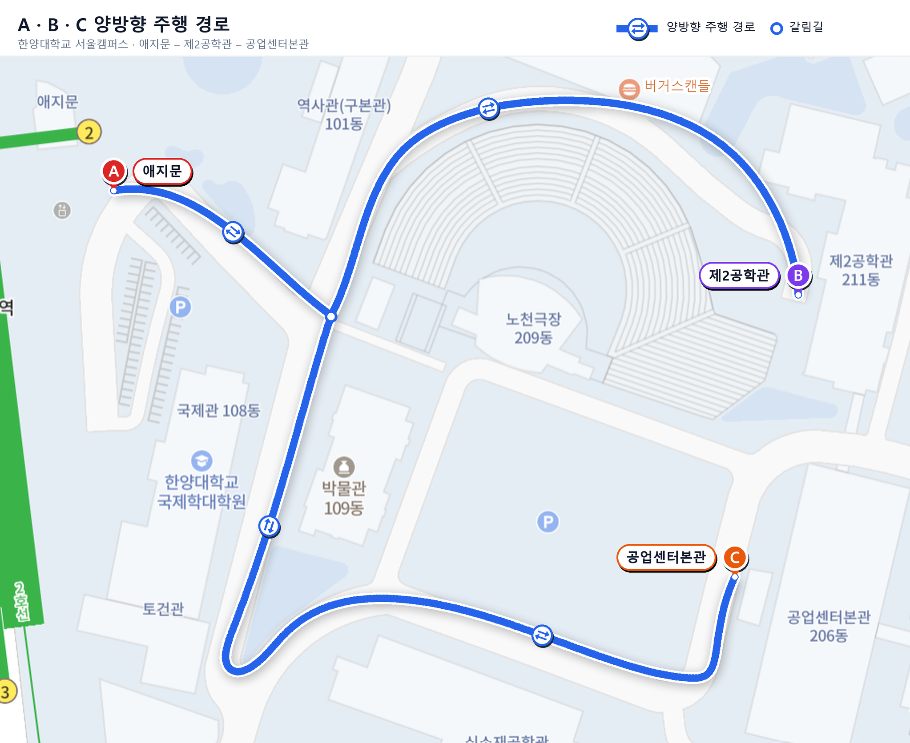
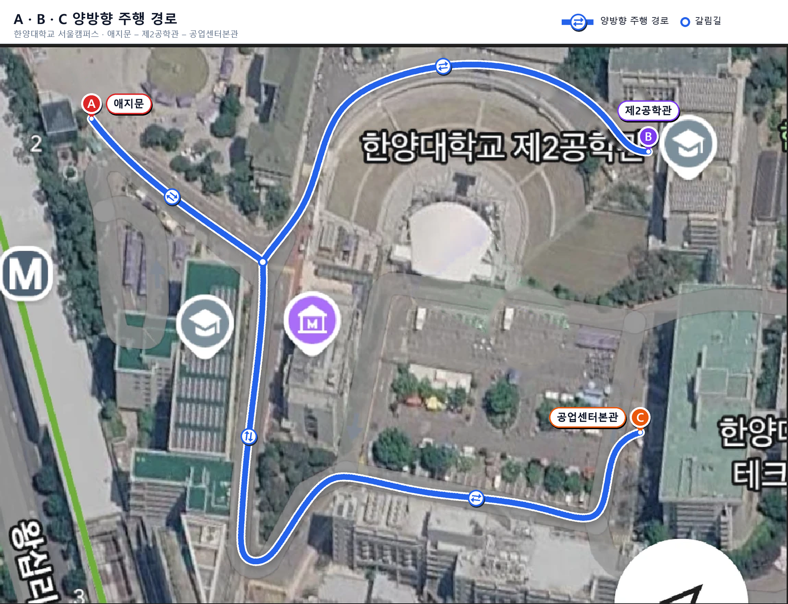

# UNICON 자율주행 휠체어 프로젝트

한양대학교 서울캠퍼스에서 자율주행 전동 휠체어를 개발하는 UNICON Lab 프로젝트.

미리 만든 3D 지도와 미리 정한 경로를 따라 달린다. 순서는 ① 지도로 위치 추정 → ② 경로를 따라갈 속도 선택 → ③ 지도에 없는 물체 회피다.

> 기준: 이전 레포 main = `db6b814` (2026-08-28) · 정리 2026-10-12

---

## 1. 새 경로 시나리오

경로 위 **어느 위치에서든** 목적지 번호 `1` `2` `3`을 입력하면 그 목적지로 주행한다.

### 1.1 경로 지도

| 레이어 지도 | 위성 지도 |
|:---:|:---:|
|  |  |

### 1.2 목적지 입력

| 입력 | 목적지 |
|:---:|---|
| `1` | **A** 애지문 |
| `2` | **B** 제2공학관 (211동) |
| `3` | **C** 공업센터본관 (206동) |

### 1.3 구간 그래프

```
        A (애지문)
        │
        J (갈림길)
       ╱ ╲
      B   C
(제2공학관) (공업센터본관)
```

- **갈림길 J**: 애지문에서 내려와 B·C 방향으로 갈라지는 Y자 지점 (지도의 흰 점)
- 구간 3개 × 양방향 = **경로 파일 6개**: `A→J`, `J→A`, `J→B`, `B→J`, `J→C`, `C→J`

### 1.4 현재 위치별 주행 경로

목적지가 다른 가지에 있으면 어느 구간에 있든 갈림길 J를 거쳐 간다.

| 현재 위치 | `1` → A | `2` → B | `3` → C |
|---|---|---|---|
| 애지문 ~ 갈림길 | 바로 A | J → B | J → C |
| 갈림길 ~ 제2공학관 | J → A | 바로 B | J → C |
| 갈림길 ~ 공업센터 | J → A | J → B | 바로 C |

예) 애지문~갈림길 사이에서 `3` 입력 → 갈림길 J → 공업센터

### 1.5 동작 순서

1. 목적지 입력 (`1` / `2` / `3`)
2. 측위로 현재 위치를 구해 가장 가까운 구간과 진행 방향 판정
3. 위 표대로 방향별 구간 연결 (갈림길 J 경유)
4. 연결한 경로와 안전 밴드·주행가능 마스크를 DWA follower에 넘겨 주행

> ⚠️ **반대 방향 입력 시**: 제자리 회전과 후진이 안 된다 (최소 회전반경 약 0.7 m). 원호로 U턴할 수 있을 만큼 넓은 회차 지점이 필요하다.

---

## 2. 후속 과제

### 2.1 제2공학관 구간 신규 매핑

**현황**
- 지금 지도는 애지문 ↔ 공업센터 구간만 있다 (07-07 · 07-25 매핑).
- 갈림길 J → 제2공학관 구간은 지도가 없어서 측위도 경로 생성도 안 된다.

**필요 작업**
1. J↔B 구간 매핑 주행 (rosbag 기록)
2. GLIM으로 재처리해서 기존 지도에 병합
3. J↔B 경로·안전 밴드·마스크 생성
4. 측위 검증 (TRACKING 유지 확인)

> 기존 지도 좌표계에 고정해서 병합하면 기존 v9 경로 자산을 그대로 쓸 수 있다.

### 2.2 주간 주행을 위한 장애물 회피 수정

**현황**
- 지금까지는 주로 밤·새벽에 달려서 회피할 상황이 거의 없었다.
- 움직이는 물체와 사람은 `WAIT`(정지)하고, 정지한 물체만 비켜 간다.
- 사람 옆 통과는 10초 넘게 멈춰 있을 때만 한다 (`PERSON_BYPASS`).

**주간 문제 → 수정 방향**

| 문제 | 수정 방향 |
|---|---|
| 보행자가 늘 있어서 정지를 반복하고 앞으로 못 감 | 보행자 궤적을 예측해서 회피하거나 감속 통과 |
| `WAIT`가 길어짐 | 타임아웃·재판단 정책 |
| 주간 상황 데이터 없음 | 주간 데이터로 탐지·회피 튜닝과 검증 |

### 2.3 인도 vs 차도: 경로 위치 재검토

인도는 폭이 좁아서 (v9 밴드 좌+우 폭 최소 1.20 m, 중앙값 3.35 m) 낮에 보행자를 비켜 갈 공간이 모자라고, 그래서 자주 멈춘다. 2.2와 이어지는 문제다.

| 항목 | 인도 (현재) | 차도 |
|---|---|---|
| 회피 공간 | 좁음 | 넓음 |
| 보행자 | 많음 (주간) | 적음 |
| 차량 | 없음 | 함께 다님 → 차량 감지·대응 필요 |
| 연석·낙차 | 밴드로 막고 있음 | 연석에 다가갈 일이 적음 |
| 필요 작업 | 회피 로직 수정 | 차도 경로·밴드 새로 생성 + 빠르게 움직이는 물체 대응 |

> 🔶 **결정 필요**: 차도 경로를 쓸지 정해야 한다 (전 구간 / 혼잡 구간만 / 지금처럼 인도 유지).

---

## 참고: 현재 시스템 요약

<details>
<summary>알고리즘 구조 (펼치기)</summary>

**오프라인 (사전 준비)**
주행 기록 rosbag (MID-360 점군 + IMU, 07-07 · 07-25 매핑 3회) → GLIM 재처리·3회 병합·포즈 그래프 최적화 → 고정 3D 지도 (0.20 m PCD) → 주행 자산 3종 (경로·안전 밴드·마스크, SHA-256으로 묶음)

**온라인 (주행 중, 제어 10 Hz)**
Livox MID-360 → FAST-LIO (상대 이동) + GICP 지도 정합 (`/fast_lio_icp/pose`) → DWA follower (`/cmd_vel_raw`) → 안전 체인 (`safety_gate` → `tip_guard`) → 바퀴 드라이버
장애물 요약 `obstacle_clusters` (5 Hz)로 정지/이동 판정과 회피 결정

| 항목 | 내용 |
|---|---|
| 경로 | v9 = 08-20 손으로 다시 그린 중심선 (383 m · 1,917점, 0.2 m 간격) |
| 속도 | 최대 0.8 m/s · 최저 0.35 m/s, 후진 금지 |
| 최소 회전반경 | 약 0.7 m (0.35 m/s ÷ 0.5 rad/s), 제자리 회전 불가 |
| DWA | 후보 속도 5 × 회전 21, 1.05 m 원호 예측, 장애물 검사 3.0 m |
| 장애물 동작 | `GO_ROUND` (정지 물체) / `WAIT` (이동 물체·사람) / `PERSON_BYPASS` (10초 넘게 멈춘 사람) |
| 측위 보정 승인 | fitness ≤ 0.28 · inlier ≥ 0.20 · 점프 ≤ 1.5 m / 20°, 1회 적용 한도 0.20 m / 2° |

</details>
